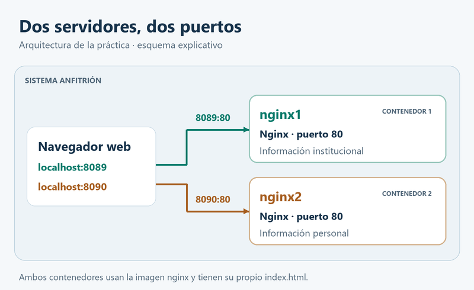
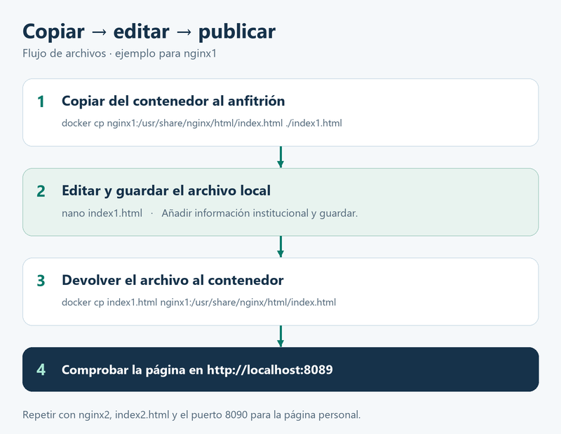
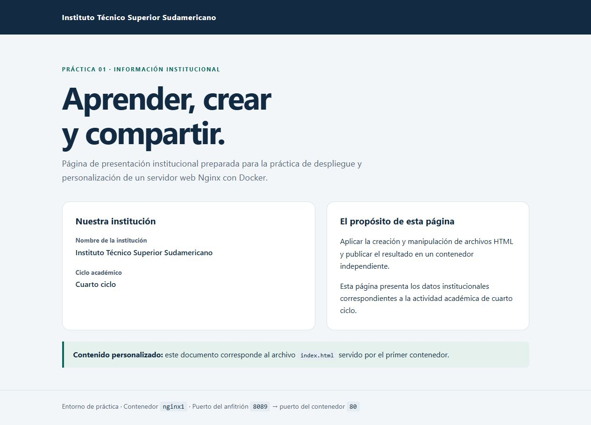
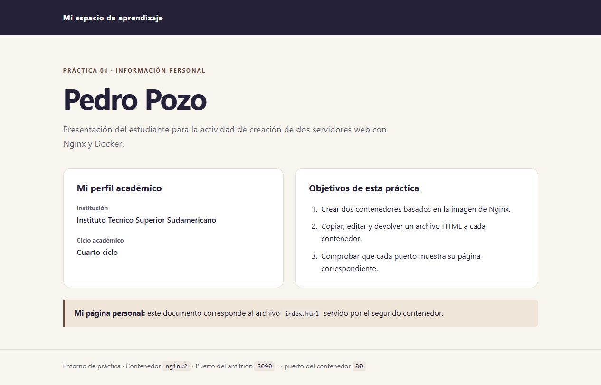

# Práctica 1: dos servidores web con Nginx y Docker

**Estudiante:** Pedro Pozo  
**Institución:** Instituto Técnico Superior Sudamericano  
**Ciclo:** Cuarto

## 1. Título

Creación y personalización de dos servidores web Nginx mediante contenedores Docker y manipulación de archivos en Linux.

## 2. Fundamentos:

Un servidor web recibe una solicitud del navegador y responde con el contenido de una página. En esta práctica se utilizó Nginx para mostrar documentos HTML. Son páginas estáticas porque su contenido está guardado en un archivo y no depende de una base de datos. Al visitar la dirección del servidor, el navegador recibe ese archivo y muestra los títulos, párrafos y demás elementos que contiene. ([NGINX, s. f.](https://nginx.org/en/docs/beginners_guide.html))

Docker permite ejecutar programas en contenedores. Una imagen contiene los archivos que sirven como base para crearlos; el contenedor es la instancia que se pone en funcionamiento. En este caso se utilizó la misma imagen de Nginx para crear dos contenedores, llamados `nginx1` y `nginx2`. Aunque parten de la misma imagen, cada uno tiene sus propios archivos y puede mostrar una página distinta. La opción `-d` permite dejarlos funcionando en segundo plano. ([Docker, s. f.-c](https://docs.docker.com/engine/containers/run/))

Para acceder a las páginas es necesario publicar los puertos. Nginx escucha en el puerto 80 dentro de cada contenedor. En la computadora se asignó el puerto 8089 al primero y el 8090 al segundo. Por eso, `8089:80` significa que las solicitudes recibidas en el puerto 8089 se dirigen al puerto 80 de `nginx1`. Usar puertos distintos en el anfitrión permite consultar ambos servidores al mismo tiempo. ([Docker, s. f.-b](https://docs.docker.com/get-started/docker-concepts/running-containers/publishing-ports/))

El archivo `index.html` contiene la página inicial del servidor. HTML organiza la información mediante etiquetas: por ejemplo, `h1` sirve para un título y `p` para un párrafo. La codificación UTF-8 permite mostrar correctamente las tildes. En el primer documento se colocó el nombre del instituto y en el segundo, el nombre del estudiante y su ciclo. Los estilos CSS incluidos en cada archivo dan formato a esos datos. ([MDN Web Docs, s. f.](https://developer.mozilla.org/es/docs/Learn_web_development/Core/Structuring_content/Basic_HTML_syntax))

El comando `docker cp` permite copiar archivos entre la computadora y un contenedor. El proceso consiste en sacar el archivo original, editarlo y devolverlo a la misma ruta. Las copias locales se llamaron `index1.html` e `index2.html` para distinguirlas, pero dentro de cada contenedor conservaron el nombre `index.html`. Antes de copiar hay que revisar la carpeta de trabajo y el nombre del contenedor para no modificar el servidor equivocado. ([Docker, s. f.-a](https://docs.docker.com/reference/cli/docker/container/cp/))

La comprobación se realizó desde la terminal y el navegador. `docker ps` permitió revisar el estado de los contenedores y `curl` obtuvo las páginas por HTTP. La respuesta 200 indicó que la solicitud se atendió correctamente. También se revisaron los textos y se compararon las respuestas con los archivos locales. Así se comprobó que cada puerto mostraba la página correspondiente.



*Figura 1. Esquema de los dos contenedores y sus puertos.*



*Figura 2. Copia, edición y devolución del archivo HTML.*

## 3. Conocimientos previos.

- Uso de una terminal Linux y comandos como `pwd`, `mkdir`, `cd`, `ls` y `cat`.
- Diferencia entre rutas absolutas y relativas.
- Edición y guardado de archivos con Nano o Vi.
- Estructura básica de un documento HTML y codificación UTF-8.
- Diferencia entre imagen, contenedor, anfitrión y puerto.
- Uso del navegador, captura de pantalla y manejo básico de GitHub.

## 4. Objetivos a alcanzar

- Crear dos contenedores llamados `nginx1` y `nginx2` a partir de la imagen `nginx`.
- Publicar sus servicios en los puertos 8089 y 8090 del anfitrión.
- Copiar, editar y devolver el archivo `index.html` de cada contenedor.
- Mostrar información institucional en el primero e información del estudiante en el segundo.
- Verificar el servicio HTTP y la correspondencia entre cada puerto y su contenido.
- Documentar la práctica en Markdown y compartir el informe mediante GitHub.

## 5. Equipo necesario:

| Recurso | Entorno verificado o recurso para la entrega |
| --- | --- |
| Computador | Equipo con Windows y Ubuntu 24.04.4 LTS mediante WSL2 |
| Terminal | Sesión Linux dentro de Ubuntu/WSL |
| Docker | Cliente y servidor Docker Engine 29.8.0, arquitectura Linux/amd64 |
| Imagen | Imagen oficial `nginx:latest`; Nginx 1.31.7 comprobado en ambos contenedores |
| Editor | Vi disponible en `/usr/bin/vi`, utilizado en modo Ex |
| Comprobación | Navegador y `curl` |
| Conectividad | Acceso a Docker Hub y GitHub |
| Cuenta | Cuenta GitHub del estudiante para publicar el repositorio |
| Audio | Micrófono y herramienta que permita guardar o exportar MP3 |

El registro contiene las salidas de `docker version`, `/etc/os-release` y `nginx -v` en ambos contenedores. La imagen descargada tiene el identificador `sha256:bc4cad49969aaf95eb4eecec5572846f86e59f1e8332aba36ed64b91aff8b724`. Los comandos de la sección siguiente se ejecutan dentro de Linux, aunque el navegador se abra desde Windows.

## 6. Material de apoyo.

- Consigna de la Práctica 1 proporcionada por la asignatura.
- [Plantilla del informe](https://github.com/maguaman2/informe-tendencias/blob/main/informe.md).
- [Docker: ejecución de contenedores](https://docs.docker.com/engine/containers/run/).
- [Docker: copia de archivos](https://docs.docker.com/reference/cli/docker/container/cp/).
- [Docker: publicación de puertos](https://docs.docker.com/get-started/docker-concepts/running-containers/publishing-ports/).
- [Imagen oficial de Nginx](https://hub.docker.com/_/nginx).
- [Guía introductoria de Nginx](https://nginx.org/en/docs/beginners_guide.html).
- [Manual de Nano](https://www.nano-editor.org/dist/latest/nano.html).
- [Video guía indicado por el docente](https://drive.google.com/file/d/1UTxRWaQPCHITq7u5l0mXEmRk49m__tlf/view). Recurso indicado en la consigna.

## 7. Procedimiento

Se trabajó desde la terminal de Ubuntu. Primero se crearon los dos contenedores; después se copiaron, editaron y devolvieron sus archivos HTML. La edición se hizo con Vi en modo Ex. También se indica cómo abrir los archivos con Nano para repetir el ejercicio.

### Paso 1. Preparar el directorio de trabajo en Linux

Se trabajó en Ubuntu/WSL2 dentro de una carpeta de práctica y se comprobó la disponibilidad de Docker, Vi y los puertos. Para repetir la preparación, situarse en la carpeta descargada de estos materiales, que contiene `index1.html` e `index2.html`. La variable `out` conserva su ubicación y la subcarpeta `ejecucion` separa las copias de trabajo:

La ejecución registrada utilizó una sesión con permisos de administrador y un directorio de práctica dentro de `~/snap/docker/common/`. En una instalación de Docker mediante Snap, esta ubicación permite que los materiales sean accesibles. Si la cuenta no tiene acceso al servicio de Docker, anteponer `sudo` a sus comandos.

```bash
out="$(pwd)"
mkdir -p ejecucion/evidencias
cd ejecucion
pwd
docker version
docker info
docker ps -a --format 'table {{.Names}}\t{{.Status}}\t{{.Ports}}'
```

Docker mostró información tanto del cliente como del servidor. La consulta de puertos no mostró servicios escuchando en 8089 ni 8090. Al repetir el ejercicio, si aparecen contenedores previos llamados `nginx1` o `nginx2`, revisarlos antes de continuar; no eliminarlos automáticamente. Comprobar los puertos con:

```bash
ss -ltn '( sport = :8089 or sport = :8090 )'
```

### Paso 2. Crear el primer contenedor

Se creó el primer contenedor con el comando:

```bash
docker run -d --name nginx1 -p 8089:80 nginx
```

`--name` asigna el nombre `nginx1`, `-d` lo deja en segundo plano y `-p` publica el servicio en el puerto 8089.

### Paso 3. Crear el segundo contenedor

```bash
docker run -d --name nginx2 -p 8090:80 nginx
docker ps --format 'table {{.Names}}\t{{.Status}}\t{{.Ports}}'
docker exec nginx1 nginx -v
docker exec nginx2 nginx -v
```

Comprobar que ambos aparecen activos y que sus puertos publicados corresponden a los indicados. Los comandos usan la etiqueta implícita `latest`; anotar la versión efectiva mostrada por Nginx para identificar el entorno utilizado.

### Paso 4. Copiar y editar el archivo del primer contenedor

```bash
docker cp nginx1:/usr/share/nginx/html/index.html ./index1.html
cp index1.html index1-original.html
vi -n -es -c '%delete _' -c "0read $out/index1.html" -c wq index1.html
cmp index1.html "$out/index1.html"
```

Con Vi se sustituyó la página de bienvenida por el contenido institucional. La variable `$out`, definida en el paso 1, señala la carpeta de los HTML incluidos en el repositorio. `cmp` comprobó que la copia editada coincidiera con el archivo previsto.

Como alternativa de reproducción manual, abrir `nano index1.html` y editar el contenido. Puede utilizarse la siguiente estructura mínima; el archivo `index1.html` incluido con los materiales ofrece la presentación completa utilizada.

```html
<!doctype html>
<html lang="es">
<head>
  <meta charset="utf-8">
  <meta name="viewport" content="width=device-width, initial-scale=1">
  <title>Información institucional</title>
</head>
<body>
  <h1>Información institucional</h1>
  <h2>Instituto Técnico Superior Sudamericano</h2>
  <p>Práctica 1: creación de servidores web con Nginx y Docker.</p>
  <p>Servidor: nginx1. Puerto del anfitrión: 8089.</p>
</body>
</html>
```

Si se elige la alternativa con Nano, guardar con `Ctrl+O`, confirmar el nombre con `Enter` y salir con `Ctrl+X`. Revisar el contenido y permitir su lectura:

```bash
cat index1.html
chmod 644 index1.html
```

### Paso 5. Devolver el archivo al primer contenedor

```bash
docker cp index1.html nginx1:/usr/share/nginx/html/index.html
docker exec nginx1 cat /usr/share/nginx/html/index.html
```

La ruta de destino termina en `index.html`, aunque la copia local se llame `index1.html`. Se modifica el contenido del sitio, no la configuración de Nginx. La sustitución de una página estática normalmente se observa al actualizar el navegador.

### Paso 6. Copiar y editar el archivo del segundo contenedor

```bash
docker cp nginx2:/usr/share/nginx/html/index.html ./index2.html
cp index2.html index2-original.html
vi -n -es -c '%delete _' -c "0read $out/index2.html" -c wq index2.html
cmp index2.html "$out/index2.html"
```

Se repitió el método con Vi y se comprobó la coincidencia con el HTML personal preparado. Para reproducir la edición manualmente puede utilizarse `nano index2.html`. La estructura mínima del contenido es:

```html
<!doctype html>
<html lang="es">
<head>
  <meta charset="utf-8">
  <meta name="viewport" content="width=device-width, initial-scale=1">
  <title>Información personal</title>
</head>
<body>
  <h1>Información personal</h1>
  <p>Estudiante: Pedro Pozo.</p>
  <p>Institución: Instituto Técnico Superior Sudamericano.</p>
  <p>Ciclo: cuarto.</p>
  <p>Servidor: nginx2. Puerto del anfitrión: 8090.</p>
</body>
</html>
```

En la alternativa con Nano, guardar con `Ctrl+O`, confirmar con `Enter` y salir con `Ctrl+X`. Si se utiliza el HTML incluido con los materiales, conservar estos datos y el texto distintivo «Información personal».

```bash
cat index2.html
chmod 644 index2.html
```

### Paso 7. Devolver el archivo al segundo contenedor

```bash
docker cp index2.html nginx2:/usr/share/nginx/html/index.html
docker exec nginx2 cat /usr/share/nginx/html/index.html
```

Comprobar que el destino pertenece a `nginx2`. Las dos rutas interiores son iguales, pero cada contenedor mantiene su propio archivo.

### Paso 8. Verificar el estado, la respuesta HTTP y el contenido

```bash
docker ps --format 'table {{.Names}}\t{{.Status}}\t{{.Ports}}'
docker port nginx1
docker port nginx2
curl --retry 5 --retry-connrefused --max-time 15 --fail --silent --show-error -D evidencias/cabeceras-nginx1.txt -o evidencias/respuesta-nginx1.html -w 'nginx1 HTTP %{http_code}\n' http://localhost:8089/
curl --retry 5 --retry-connrefused --max-time 15 --fail --silent --show-error -D evidencias/cabeceras-nginx2.txt -o evidencias/respuesta-nginx2.html -w 'nginx2 HTTP %{http_code}\n' http://localhost:8090/
grep -F 'Información institucional' evidencias/respuesta-nginx1.html
grep -F 'Instituto Técnico Superior Sudamericano' evidencias/respuesta-nginx1.html
grep -F 'Información personal' evidencias/respuesta-nginx2.html
grep -F 'Pedro Pozo' evidencias/respuesta-nginx2.html
cmp index1.html evidencias/respuesta-nginx1.html && echo 'nginx1: contenido servido idéntico al archivo local'
cmp index2.html evidencias/respuesta-nginx2.html && echo 'nginx2: contenido servido idéntico al archivo local'
sha256sum index1.html index2.html evidencias/respuesta-nginx1.html evidencias/respuesta-nginx2.html
```

Se obtuvo **HTTP 200 en ambos puertos**, se encontraron los textos previstos y `cmp` confirmó que cada respuesta coincidía con su archivo local. Los hashes SHA-256 también coincidieron para cada pareja de archivos. Las salidas completas figuran en el registro de ejecución. Si al repetir aparece una diferencia, debe corregirse antes de dar por terminada la verificación.

Abrir en el navegador:

- [Servidor institucional: localhost:8089](http://localhost:8089/).
- [Servidor personal: localhost:8090](http://localhost:8090/).

Si Docker está en una máquina remota, utilizar su dirección en lugar de `localhost`. En WSL, comprobar primero desde la terminal Linux y después desde el navegador de Windows; registrar cualquier diferencia.

### Paso 9. Conservar las evidencias reales

Se guardaron los siguientes archivos en `evidencias/`:

| Evidencia | Contenido |
| --- | --- |
| [Registro de ejecución](evidencias/registro-ejecucion.txt) | Comandos, versiones, descarga, estado de contenedores, incidencia, corrección y verificaciones; rutas locales abreviadas |
| [Cabeceras de nginx1](evidencias/cabeceras-nginx1.txt) y [cabeceras de nginx2](evidencias/cabeceras-nginx2.txt) | Respuestas HTTP 200 y datos del servidor |
| [Respuesta de nginx1](evidencias/respuesta-nginx1.html) y [respuesta de nginx2](evidencias/respuesta-nginx2.html) | Cuerpos HTML recuperados por HTTP |
| [Original de nginx1](evidencias/index1-original.html) y [original de nginx2](evidencias/index2-original.html) | Copias de las páginas predeterminadas antes de personalizarlas |
| [Captura institucional](evidencias/04-institucional.png) y [captura personal](evidencias/05-personal.png) | Páginas reales abiertas en el navegador; se muestran en la sección 8 |
| [Registro de capturas](evidencias/capturas-navegador.txt) | Direcciones consultadas para obtener las capturas |

Las capturas muestran las páginas abiertas en `http://localhost:8089/` y `http://localhost:8090/`. Las direcciones consultadas constan en el registro de capturas.

### Paso 10. Corregir el error de edición

En el primer intento con Vi se eliminó por error la última línea del HTML. `cmp` detectó que la copia ya no coincidía con el archivo preparado. Se quitó la instrucción `$delete _`, se repitió la edición y se volvió a comparar. Después de corregirlo, se copió el archivo al contenedor. El error y su corrección aparecen en el registro de ejecución.

Las copias locales se conservaron para poder repetir el ejercicio. Si se elimina un contenedor, los cambios de sus archivos que no estén guardados fuera de él también se pierden. ([Docker, s. f.-c](https://docs.docker.com/engine/containers/run/))

### Paso 11. Publicar el informe y preparar la entrega

El informe reúne los datos del estudiante, las páginas y las evidencias. Los materiales se organizan en el repositorio independiente `practica-1-nginx-docker`, con `informe.md`, `README.md`, `index1.html` e `index2.html` en la raíz y las carpetas `images/`, `evidencias/` y `audio/` para los recursos correspondientes.

**Enlace de entrega:** [Informe de la Práctica 1 en GitHub](https://github.com/pozosaurio-stack/practica-1-nginx-docker/blob/main/informe.md).

Grabar con la voz del estudiante una reflexión de 60 segundos, utilizando [el guion de apoyo](audio/guion-audio.md) solo después de ajustarlo a lo aprendido. Guardarla como MP3 y comprobar su duración. El guion no reemplaza el archivo de audio.

## 8. Resultados esperados:

| Aspecto | Resultado esperado | Resultado observado |
| --- | --- | --- |
| Contenedores | `nginx1` y `nginx2` activos | Ambos figuran activos en el registro, con `8089:80` y `8090:80` respectivamente |
| Primer servicio | Puerto 8089, HTTP 200, información institucional | HTTP 200; se verificaron «Información institucional» y «Instituto Técnico Superior Sudamericano» |
| Segundo servicio | Puerto 8090, HTTP 200, información de Pedro Pozo | HTTP 200; se verificaron «Información personal» y «Pedro Pozo» |
| Copias de archivos | Ambos HTML servidos coinciden con las copias locales | `cmp` sin diferencias y hashes SHA-256 iguales en cada pareja |
| Capturas | Evidencia real, con títulos y ancho máximo de 800 px | Dos capturas de las páginas servidas por HTTP, incluidas abajo |
| Informe Markdown | Documento con evidencias y fuentes | Informe, páginas, registros e imágenes organizados en el repositorio `practica-1-nginx-docker`; enlace de entrega en el paso 11 |
| Reflexión oral | MP3 con voz del estudiante y duración de 60 segundos | Pendiente de grabación |



*Figura 3. Página institucional del Instituto Técnico Superior Sudamericano servida por nginx1. Dirección consultada: [localhost:8089](http://localhost:8089/).*



*Figura 4. Página personal de Pedro Pozo servida por nginx2. Dirección consultada: [localhost:8090](http://localhost:8090/).*

**Conclusión:** los dos servidores funcionaron con la misma imagen de Nginx y mostraron contenidos distintos. El puerto 8089 presentó la información del instituto y el 8090, los datos de Pedro Pozo. La práctica permitió comprobar cómo se copia y modifica una página dentro de un contenedor. El error de edición también mostró la importancia de revisar el archivo antes de devolverlo al servidor. Las dos respuestas HTTP fueron 200 y coincidieron con los HTML guardados en la computadora.

## 9. Bibliografía

- Docker. (s. f.-a). *[docker container cp](https://docs.docker.com/reference/cli/docker/container/cp/)*. Docker Docs. Recuperado el 19 de octubre de 2026.
- Docker. (s. f.-b). *[Publishing and exposing ports](https://docs.docker.com/get-started/docker-concepts/running-containers/publishing-ports/)*. Docker Docs. Recuperado el 19 de octubre de 2026.
- Docker. (s. f.-c). *[Running containers](https://docs.docker.com/engine/containers/run/)*. Docker Docs. Recuperado el 19 de octubre de 2026.
- Docker Official Images. (s. f.). *[nginx](https://hub.docker.com/_/nginx)*. Docker Hub. Recuperado el 19 de octubre de 2026.
- GNU nano. (s. f.). *[The GNU nano text editor](https://www.nano-editor.org/dist/latest/nano.html)*. Recuperado el 19 de octubre de 2026.
- maguaman2. (s. f.). *[informe.md](https://github.com/maguaman2/informe-tendencias/blob/main/informe.md)* [Plantilla de informe]. GitHub. Recuperado el 19 de octubre de 2026.
- MDN Web Docs. (s. f.). *[Sintaxis básica de HTML](https://developer.mozilla.org/es/docs/Learn_web_development/Core/Structuring_content/Basic_HTML_syntax)*. Recuperado el 19 de octubre de 2026.
- NGINX. (s. f.). *[Beginner’s guide](https://nginx.org/en/docs/beginners_guide.html)*. Recuperado el 19 de octubre de 2026.
